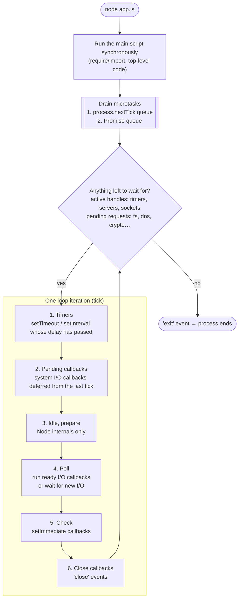
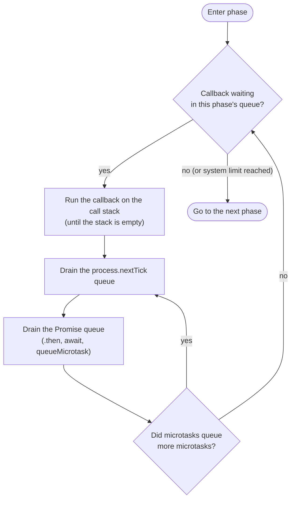
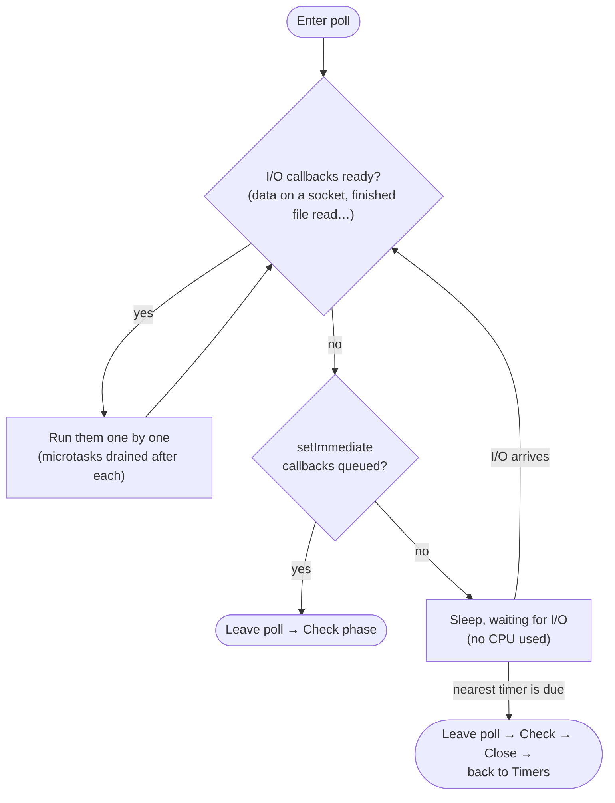

# Node.js Event Loop — the essentials

## 1. The big picture

- Node.js runs your JavaScript on **one main thread**. Only one piece of JS executes at a time.
- Node stays fast with one thread because slow work (network, disk, timers) is **handed off**. The main thread just reacts to the results through callbacks.
- The **event loop** decides which callback runs next. It is implemented by **libuv**, the C library underneath Node.
- **V8**, the JavaScript engine, runs the code. It owns the **call stack** and the **Promise microtask queue**.

```
┌──────────────────────────┐
│   Your JS (call stack)   │  ← V8, single thread
└────────────┬─────────────┘
             │ async request (fs, net, timers, crypto…)
             ▼
┌──────────────────────────┐
│          libuv           │
│  ├─ event loop (phases)  │
│  ├─ OS async I/O         │  ← epoll (Linux), kqueue (macOS), IOCP (Windows)
│  └─ thread pool (4)      │  ← fs, dns.lookup, crypto, zlib
└──────────────────────────┘
```

**Rule #1:** the event loop can only move on once the call stack is empty. Code that runs for a long time without yielding blocks **everything**: every request, every timer, every callback.

---

## 2. Phases of one loop iteration ("tick")

```
   ┌───────────────────────────┐
┌─>│          timers           │  setTimeout / setInterval callbacks whose time is up
│  └─────────────┬─────────────┘
│  ┌─────────────┴─────────────┐
│  │     pending callbacks     │  some system I/O callbacks deferred from the previous tick (e.g. TCP errors)
│  └─────────────┬─────────────┘
│  ┌─────────────┴─────────────┐
│  │       idle, prepare       │  internal to Node only
│  └─────────────┬─────────────┘
│  ┌─────────────┴─────────────┐
│  │           poll            │  wait for and run I/O callbacks (sockets, files, …)
│  └─────────────┬─────────────┘
│  ┌─────────────┴─────────────┐
│  │           check           │  setImmediate callbacks
│  └─────────────┬─────────────┘
│  ┌─────────────┴─────────────┐
└──┤      close callbacks      │  'close' events, e.g. socket.on('close')
   └───────────────────────────┘
```

Each phase has its own **first-in, first-out (FIFO) queue** of callbacks. The loop works through a phase's queue until the queue is empty or a system limit is reached, and then moves to the next phase.

### The poll phase (the most important one)
- It runs the I/O callbacks that are ready.
- If nothing is ready:
  - when `setImmediate` callbacks are queued, it ends the poll phase and moves to **check**;
  - otherwise it **blocks and waits** for I/O, but only until the nearest timer is due.
- This is why an idle Node process uses almost no CPU: it is sleeping inside the poll phase.

### Timers are a minimum, not a guarantee
`setTimeout(fn, 100)` means "no sooner than 100 ms". If the main thread is busy, the callback runs later. `setTimeout(fn, 0)` is treated as **1 ms**.

> Node 20+ (libuv 1.45): timers run only **after** the poll phase. Older versions also checked them before it. Code that depends on that exact timing is fragile anyway.

---

## 3. Microtasks: `process.nextTick` and Promises

These two queues **are not phases**. They are drained **after every single callback**, before the loop goes any further:

1. **`process.nextTick` queue**: drained completely first.
2. **Promise microtask queue** (`.then`, `await`, `queueMicrotask`): drained after that.
3. If a microtask queues more microtasks, those also run before the loop moves on.

Since Node 11, this happens **between each individual** `setTimeout` or `setImmediate` callback, which matches browser behaviour. Before Node 11 it only happened between phases.

```js
setTimeout(() => {
  console.log('timeout 1');
  Promise.resolve().then(() => console.log('promise inside timeout 1'));
});
setTimeout(() => console.log('timeout 2'));
// Node ≥ 11: timeout 1 → promise inside timeout 1 → timeout 2
```

### Starvation danger
Calling `process.nextTick` or Promise chains recursively **starves the event loop**. I/O and timers never get a turn:

```js
function forever() { process.nextTick(forever); } // I/O never runs again
```

`setImmediate` does not have this problem: callbacks scheduled from inside the check phase run on the **next** tick.

---

## 3a. The whole loop in pictures

### From `node app.js` to process exit



### What happens inside every phase

Each phase runs its callbacks one at a time, and the microtask queues are emptied **after each callback**, not once per phase:



### How the poll phase decides to wait



### Who does the actual work

The main thread never waits on I/O itself. It hands the work off and later picks up the callback:

```mermaid
sequenceDiagram
    participant JS as Your JS (main thread)
    participant Loop as Event loop (libuv)
    participant OS as Operating system async I/O
    participant Pool as Thread pool (4 threads)

    JS->>Loop: http request / socket.write
    Loop->>OS: register socket (epoll / kqueue / IOCP)
    JS->>Loop: fs.readFile / crypto.pbkdf2
    Loop->>Pool: run the job on a worker thread
    Note over JS: Call stack is now empty,<br/>so the loop keeps spinning
    OS-->>Loop: socket has data
    Loop->>JS: run the callback (poll phase)
    Pool-->>Loop: job finished
    Loop->>JS: run the callback (poll phase)
```

---

## 4. Order of execution: the classic quiz

```js
console.log('1: sync');

setTimeout(() => console.log('5/6: setTimeout'), 0);
setImmediate(() => console.log('5/6: setImmediate'));

Promise.resolve().then(() => console.log('4: promise'));
process.nextTick(() => console.log('3: nextTick'));

console.log('2: sync');
```

Output (CommonJS):
```
1: sync
2: sync
3: nextTick
4: promise
5/6: setTimeout   ┐ order NOT guaranteed in the main module:
5/6: setImmediate ┘ it depends on whether 1 ms passed before the loop started
```

### `setTimeout(0)` vs `setImmediate`
- **In the main module:** the order is not deterministic.
- **Inside an I/O callback:** `setImmediate` **always** runs first, because the check phase comes directly after the poll phase.

```js
require('fs').readFile(__filename, () => {
  setTimeout(() => console.log('timeout'), 0);
  setImmediate(() => console.log('immediate')); // always first here
});
```

### ES modules gotcha
In an ES module (`.mjs` or `"type": "module"`), the module itself is evaluated inside a Promise job, so the order is **promise first, then nextTick**. Don't build logic that depends on this ordering.

### `async`/`await`
Everything after an `await` is a **Promise microtask**. A function stays synchronous up to its first `await`:

```js
async function f() {
  console.log('A');      // synchronous
  await null;
  console.log('C');      // microtask
}
f(); console.log('B');   // A, B, C
```

---

## 5. The libuv thread pool

Not all async work is the same:

| Kind of work | How it's done |
|---|---|
| Network (TCP, UDP, HTTP sockets) | Operating-system async I/O (epoll/kqueue/IOCP), **no thread pool** |
| File system (`fs.*` async) | Thread pool |
| `dns.lookup` (used by `http.get('host')`) | Thread pool |
| `crypto.pbkdf2`, `scrypt`, `randomBytes`, `randomFill` (async) | Thread pool |
| `zlib` async compression | Thread pool |
| `dns.resolve*` | Network (c-ares library), no thread pool |

- The default size is **4 threads**. Change it with the environment variable `UV_THREADPOOL_SIZE` (maximum 1024). Set it **before** the pool is first used, ideally when the process starts.
- Symptom of an undersized pool: 4 slow file reads or `pbkdf2` calls make the 5th one (and the DNS lookups behind HTTP calls) wait in line.

---

## 6. What blocks the event loop (avoid on hot paths)

- Synchronous APIs: `fs.readFileSync`, `crypto.pbkdf2Sync`, `zlib.gzipSync`, `child_process.execSync`.
- `JSON.parse` or `JSON.stringify` on large payloads (megabytes).
- Heavy CPU loops: sorting or transforming huge arrays, image processing, compression in JS.
- **Catastrophic regular-expression backtracking** (e.g. `/(a+)+$/` on attacker-controlled input). This is a real denial-of-service vector.
- Huge synchronous loops over request data.

### Fixes
- **`worker_threads`** for CPU-heavy work. It gives you real parallel JS on separate threads.
- **Chunking**: split the work into pieces and yield between them with `setImmediate`.
- **Streams** instead of loading big files or bodies into memory.
- Move the work to another process or service (a queue plus a worker).
- `child_process` or `cluster` to use more CPU cores (one event loop per process).

```js
// Chunking example
function processInChunks(items, handle, chunkSize = 1000) {
  let index = 0;
  function nextChunk() {
    const end = Math.min(index + chunkSize, items.length);
    for (; index < end; index++) handle(items[index]);
    if (index < items.length) setImmediate(nextChunk); // let I/O run in between
  }
  nextChunk();
}
```

---

## 7. When does the process exit?

Node exits when the loop has **nothing left to wait for**: no active **handles** (timers, servers, open sockets) and no pending **requests** (an in-flight `fs` operation, for example).

- `timer.unref()` / `server.unref()`: "don't keep the process alive just for this".
- `timer.ref()`: undo `unref()`.
- A Promise that never settles does **not** keep the process alive by itself. It isn't a handle.

---

## 8. Measuring event loop health

```js
const { monitorEventLoopDelay, performance } = require('node:perf_hooks');

const histogram = monitorEventLoopDelay({ resolution: 20 });
histogram.enable();
setInterval(() => {
  console.log('p99 delay (ms):', histogram.percentile(99) / 1e6);
  console.log('utilization:', performance.eventLoopUtilization().utilization);
  histogram.reset();
}, 5000);
```

- **Event loop delay (lag)**: how late callbacks run compared to when they were scheduled. A p99 above roughly 50–100 ms in a web server means something is blocking.
- **Event loop utilization**: the fraction of time the loop is busy rather than idle in poll. Close to 1.0 means CPU-bound and saturated.
- Profiling tools: `node --cpu-prof`, `node --inspect` plus Chrome DevTools, `clinic doctor` / `clinic flame`, `0x`.

---

## 9. Cheat sheet

| API | When it runs |
|---|---|
| Synchronous code | Immediately, on the call stack |
| `process.nextTick(fn)` | Right after the current operation, before Promises |
| `Promise.then`, `await`, `queueMicrotask` | After the nextTick queue, before the next macrotask |
| `setTimeout` / `setInterval` | Timers phase, once the delay has passed (minimum 1 ms) |
| I/O callbacks | Poll phase |
| `setImmediate(fn)` | Check phase, right after poll |
| `'close'` events | Close callbacks phase |

**Practical guidance**
- Prefer `setImmediate` over `process.nextTick` for "do this soon". It can't starve I/O.
- Use `process.nextTick` mainly to make an API **consistently async**, for example emitting an error event after the caller has attached its listeners.
- Never use synchronous I/O or heavy CPU work in request handlers.
- Remember there is **one event loop per process** (and one per worker thread).
- Don't write code that relies on the exact order of `setTimeout(0)` vs `setImmediate`, or of nextTick vs Promises.

---

## 10. Common interview questions (short answers)

1. **Is Node.js single-threaded?** Your JS runs on one thread. libuv uses a thread pool and operating-system async I/O behind it, and `worker_threads` can add more JS threads.
2. **`process.nextTick` vs `setImmediate`?** `nextTick` runs before the loop continues (microtask level). `setImmediate` runs in the check phase of the loop.
3. **Why can `setTimeout(fn, 0)` run after `setImmediate`?** Timer precision: the loop may reach the timers phase before 1 ms has passed. Inside an I/O callback, `setImmediate` always wins.
4. **What is event loop starvation?** Endless microtasks (nextTick or Promises) or long synchronous work stop I/O and timers from ever running.
5. **What goes to the thread pool?** File system calls, `dns.lookup`, some `crypto` functions, `zlib`. Network sockets do **not**.
6. **How do you handle CPU-heavy tasks?** `worker_threads`, chunking with `setImmediate`, offloading to another service, or `cluster` / multiple processes.
7. **How do you detect a blocked loop?** `perf_hooks.monitorEventLoopDelay`, `eventLoopUtilization`, CPU profiling.
